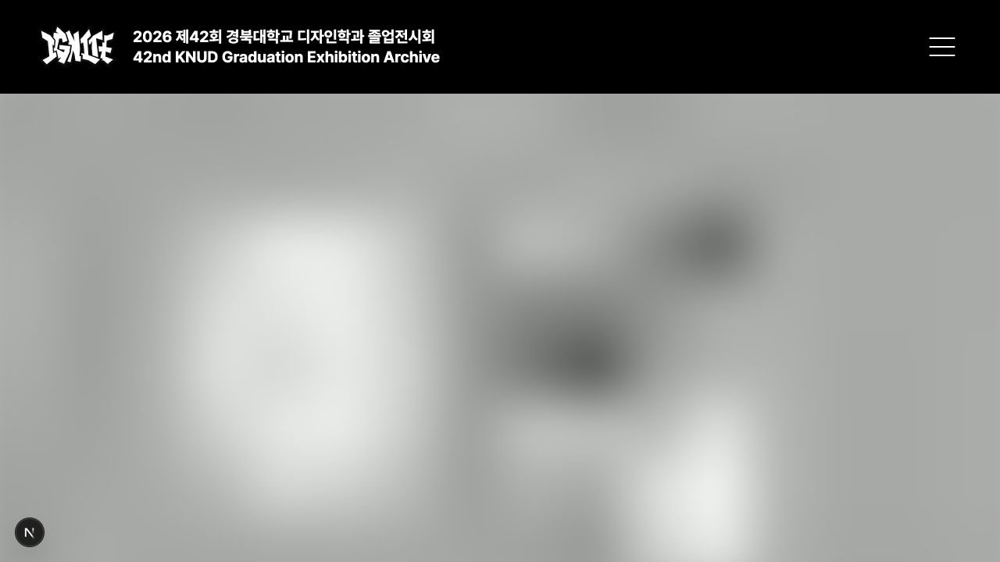

# 작품 이미지 화질 우선 제공

## 변경 이유

작품의 작은 글씨와 얇은 선이 원본보다 흐릿해 보인다는 사용자 피드백에 따라 해상도와 압축 품질을 조정한다. 기존 상세 이미지 145장 중 126장이 원본보다 축소되어 있었으며, 원본 가로 크기는 1920~8001px였다.

## 제공 기준

| 용도 | 변환 전 상한 | 변환 후 상한 | WebP 품질 |
| --- | --- | --- | --- |
| 작품 목록 썸네일 | 768px | 1536px | 90 → 95 |
| 상세 대표·본문 | 1920px | 3840px | 90 → 95 |
| SPACE hover | 1248px | 1248px | 90 유지 |

- 디자이너의 원본 파일은 변경하지 않는다. 손상된 기존 압축본을 확대하는 대신 원본에서 재생성한다.
- `withoutEnlargement`를 유지해 작은 원본을 억지로 확대하지 않는다.
- 작품 목록·상세·프로필 Work 영역은 Next Image 품질 95를 명시한다. 기존 기본값 75는 다른 화면에서 계속 허용한다.
- Next Image의 `sizes`·`srcset`으로 뷰포트와 DPR에 맞는 파일을 선택한다. 작은 화면에서 항상 3840px 전체를 다운로드하는 설정은 아니다.
- 본문은 lazy loading을 유지한다. 브라우저가 정하는 뷰포트 주변 범위부터 요청하며, 모든 본문 이미지를 eager로 요청하지 않는다.
- 3840px 제공본도 리사이즈와 손실 압축을 거치므로 원본과 픽셀 단위로 동일하지 않다. 고해상도 화면의 선명도를 높이면서 전송량을 제한하는 절충안이다. 재압축도 품질 95로 유지되지만 손실이 완전히 없어지는 것은 아니다.

## 재생성

`scripts/import-work-assets.mjs`로 현재 승인된 14명의 작품만 재생성한다. 이나경은 별도 승인된 Work 썸네일만 1536px·품질 95로 변환하고 SPACE·상세 이미지는 추가하지 않는다.

## 검수

타입 검사·관련 테스트·빌드와 함께 이미지 실제 규격이 `min(원본 폭, 용도별 상한)`이고 종횡비 오차가 1px 이내인지 확인한다. 전송량은 기존보다 늘 수 있으므로 속도가 개선되었다고 단정하지 않는다. 디자이너의 실제 작품 화질 검토가 필요하다.

- 승인된 14명·상세 145장 재생성 완료. 본문 제공본 총합은 33,613,022 → 109,192,856바이트로 늘었다. 썸네일·SPACE·대표까지 합한 제공본은 128,489,038바이트이며 원본 합계는 1,186,750,556바이트다. 이는 전체 파일 저장량이며 방문 1회당 전송량이 아니다.
- 관련 테스트 35개, ESLint, 타입 검사, 빌드와 diff 검사 통과. 실제 로컬 `/work/6` 응답의 본문 4개가 모두 `q=95`, 반응형 srcset, lazy loading을 사용하는 것을 확인했다. 이미지 최적화 엔드포인트도 품질 95 요청에 HTTP 200을 반환했다.
- SSR 단위 테스트에는 실제 Next 이미지 설정을 주입해 기본 허용 품질 75로 잘못 검증되는 것을 방지한다.
- 김연수의 원본 폴더명 `포토폴리오`도 재생성 스크립트가 인식하도록 지원했다. 번호순 정렬과 숨김 리소스 파일 제외는 유지한다.

## 작은 미리보기부터 고화질로 교체

- 작품 목록 썸네일, 상세 대표·본문, 프로필 Work 이미지에 Next Image의 `placeholder="blur"`와 `blurDataURL`을 연결했다. 승인되지 않은 상세 이미지는 추가하지 않는다.
- 이미지별 최대 16×16px·WebP 품질 40 미리보기를 빌드 자료에 포함한다. 188개 Data URL 합계는 31,384바이트이며, 개별 미리보기마다 네트워크 요청을 추가하지 않는다. JSON·HTML 구조 및 Next의 placeholder 표현에 따른 부가 용량은 이 수치에 포함하지 않는다.
- 첫 화면 대표 이미지는 즉시 요청하고, 본문은 브라우저 native lazy loading을 유지한다. 브라우저가 정하는 화면 주변 범위부터 고화질을 불러온다. 별도 IntersectionObserver나 고정 시간 타이머는 사용하지 않는다.
- 고화질 파일이 로딩·디코딩을 마치면 Next Image가 미리보기를 제거한다. 고화질 파일의 용량이나 최종 완성 시간이 줄었다고 주장하는 변경은 아니다.
- 기존 제공본에 미리보기를 추가하려면 `node scripts/generate-work-previews.mjs`를 실행한다. 이후 원본 가져오기는 `scripts/import-work-assets.mjs`가 미리보기까지 함께 생성한다.
- 캐시 비활성·1.2초 지연·60KB/s 조건에서 `/work/2` 대표 이미지의 `complete=false`, placeholder 배경 존재, `q=95` 요청을 확인했다. 정상 네트워크 복원 후 `complete=true`, placeholder 배경 `none`, `q=95`를 확인했다. 본문 37개는 lazy 상태를 유지했다.
- 관련 테스트 35개, ESLint, 타입 검사, 빌드 및 diff 검사를 통과했다. 개발환경은 준비 중 모드를 실행 시점에 끄고 `/work/2`를 열어 확인했다.

## 2026-10-19: 내용을 구분할 수 있는 미리보기

사용자가 기존 미리보기로는 어떤 사진인지 알아보기 어렵다고 피드백했다. 16px 이미지를 크게 확대하고 Next의 `blur` 모드가 SVG Gaussian blur까지 추가한 것이 원인이다. 위 16px 규격은 이 변경으로 대체한다.

- 최대 256×512px, WebP 품질 60의 미리보기를 만든다. 원본 비율·방향을 유지하고 작은 원본을 확대하지 않는다. 이미지 바이너리가 4,096바이트를 초과하면 폭·높이 상한을 75%씩 줄여 원본에서 재생성한다.
- Next Image의 `placeholder`에 Data URL을 직접 전달해 추가 블러 없이 표시한다. 기존 메타데이터 필드명 `blurDataURL`은 호환성을 위해 유지한다. 별도 이미지 요청·타이머·Client Component는 추가하지 않는다.
- 적용 범위는 작품 목록, 작품 상세 대표·본문, 프로필의 Work 이미지다. 아카이브 갤러리·SPACE 지도 hover의 별도 로딩 구조는 변경하지 않는다.
- 최종 고화질 WebP·GIF, Next 품질 95, 반응형 srcset, 본문 lazy loading과 GIF 모션 감소용 정지본은 그대로 유지한다. 이번 재생성은 매니페스트의 미리보기 데이터만 변경한다.

### 용량과 검증

- 현재 18개 작품의 241개 미리보기를 재생성했다. 실제 폭은 108~256px이며 최대 바이너리는 4,094바이트다. base64 Data URL 전체 합계는 39,323 → 947,047바이트다. 이는 모든 작품의 메타데이터 합계이며 한 방문의 전송량이 아니다.
- 가장 많은 본문을 가진 김가연 작품은 대표·본문 Data URL 합계가 143,862바이트다. HTML 스타일·React 직렬화 과정의 중복 표현과 문서 구조는 제외한 값이다. 사진 식별성을 얻는 대신 초기 문서 용량이 늘어나는 절충이며, 로딩 속도 개선이나 Lighthouse 점수 향상을 주장하지 않는다.
- 실제 브라우저 `/work/13`, 1280px에서 고화질 이미지 요청을 보류했다. 이미지 `complete=false`인 동안 직접 WebP 배경으로 포스터 배치·형태를 구분할 수 있었다. 요청을 재개한 뒤 `complete=true`, 배경 `none`, `q=95`를 확인했다. 검증용 요청 가로채기와 캐시 비활성 설정은 해제했다.
- 테스트 99개, lint, type-check, production build와 `git diff --check` 통과. 프로필 SSR 테스트의 기본 이미지 품질 경고는 기존 테스트 하네스에서 발생하며 실제 설정은 `[75, 95]`를 유지한다.
- 로컬 개발환경만 반영했다. 커밋·푸시·운영 배포 및 10월 20일 09시 예약 공개 설정은 변경하지 않았다.

