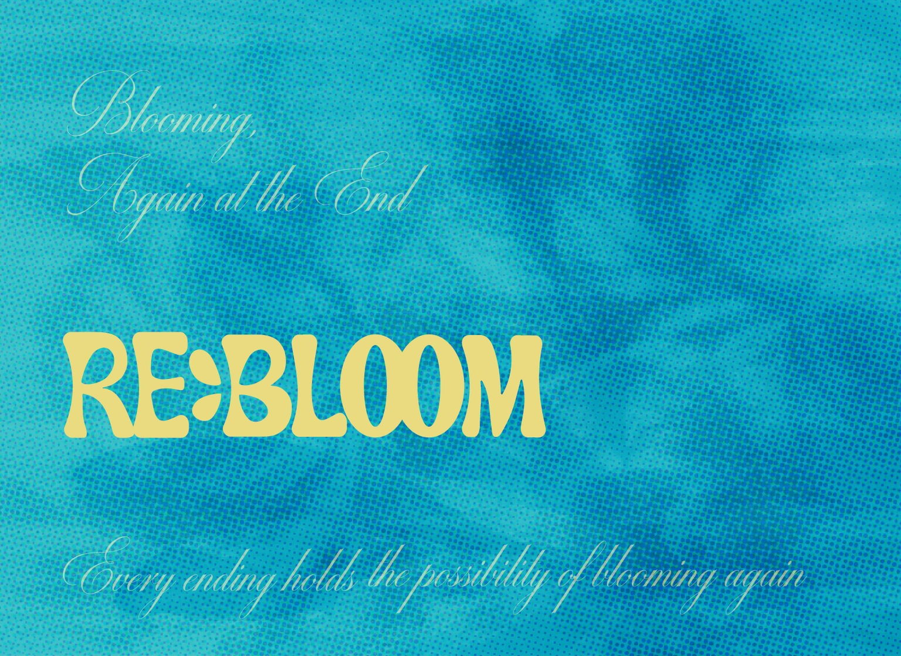
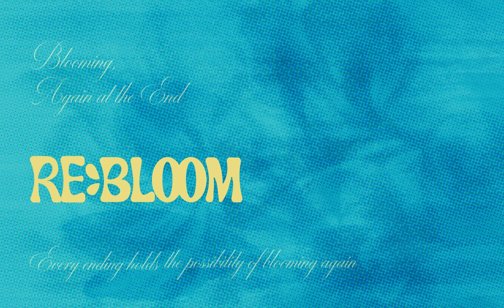

# 김서은 마지막 제출 작품 반영

## 적용 범위

- 최신 main `00a1745`에서 `feat/final-artwork` 브랜치를 생성했다.
- 전달된 `김서은_웹work` 원본은 변경하지 않고 웹용 사본만 생성했다.
- WORK 목록 `/work`, 작품 상세 `/work/4`, SPACE 지도 `/space`, 프로필 `/profile/4`의 Work 영역을 같은 REBLOOM 자료에 연결했다.
- 기존 작품명 표기, 국문·영문 소개 각 4문단, 연락처·프로필·인터뷰는 변경하지 않았다.
- 모든 19개 프로젝트가 실제 WORK·SPACE·대표·본문 이미지를 갖는다. 전체 상세 파일은 192개이며 공동 작품 하나가 두 작가 프로필에 연결된다.

## 파일 대응

| 용도 | 제출 파일 | 원본 | 제공본 |
| --- | --- | --- | --- |
| WORK | 김서은_Work.png | 1600×1167 | 1536×1120 |
| SPACE | 졸전_웹상세-08.png | 2600×1592 | 1248×764 |
| 상세 대표 | 김서은_상세.png | 8000×4375 | 3840×2100 |
| 상세 본문 | 김서은_001.png ~ 김서은_005.png | 각 폭 8000px | 각 폭 3840px, 비율 유지 |

SPACE 파일은 용도를 나타내는 이름이 없지만 제공된 썸네일 묶음 내 나머지 이미지이고, 2600×1592가 SPACE 비율에 맞으며 RE:BLOOM 표지임을 시각 확인했다. 자동 추측 규칙을 넓히는 대신 importer에 `--space-source <filename>` 옵션을 추가해 해당 파일을 명시한다. 원본 이름을 변경하지 않고 매니페스트에 출처를 보존한다. 이 파일을 본문 여섯 번째 장으로 추가하지 않는다.

## 이미지 정책

- WORK·상세는 WebP 품질 95, SPACE는 기존 품질 90을 유지한다. 리사이즈·손실 압축이 있으므로 원본과 픽셀 단위로 동일한 파일은 아니다.
- 총 8개 제공본은 8,862,832바이트이며 대응 원본 합계는 16,342,082바이트다. 한 번의 방문 전송량이나 성능 개선 수치가 아니다.
- 4KiB 이내의 식별 가능한 미리보기, 반응형 srcset, 본문 lazy loading을 유지한다. CSS·컴포넌트 배치나 전역 글자 크기는 변경하지 않는다.

## 검증

- 먼저 김서은 특이 파일명 가져오기, 전체 19개 프로젝트, 프로필의 실제 작품 링크 테스트가 누락된 구현에서 실패하는 것을 확인한 뒤 반영했다.
- 전체 30개 테스트 파일의 183개 테스트, lint, type-check, production build, diff 검사 통과. 기존 프로필 SSR 테스트의 품질 허용값 경고는 하네스에서 발생하며 실제 Next 이미지 설정은 `[75, 95]`다.
- 로컬 HTTP 200 응답에서 `/work/4`의 대표 이미지·본문 5장·기존 소개와 `/profile/4`의 `/work/4` 링크·실제 대표 이미지가 출력되는 것을 확인했다.
- Work 설정에서 브라우저 자동 사용이 꺼져 있어 이번 변경의 PC·모바일 브라우저 캡처와 시각 검수는 수행하지 못했다. 아래 자료는 실제 제공 이미지이며 브라우저 스크린샷이 아니다. 디자이너의 화면 검토를 남긴다.
- PR 생성까지만 진행한다. main 병합, 운영 배포, 메시지 DB, 기존 검수용 수동 배포와 10월 20일 오전 9시 공개 예약 설정은 변경하지 않는다. PR push에 따른 자동 Preview 빌드는 별도다.

## 제공 이미지

