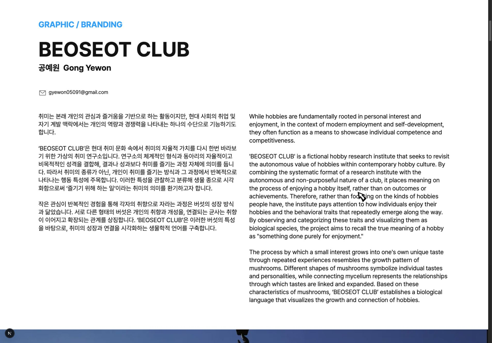
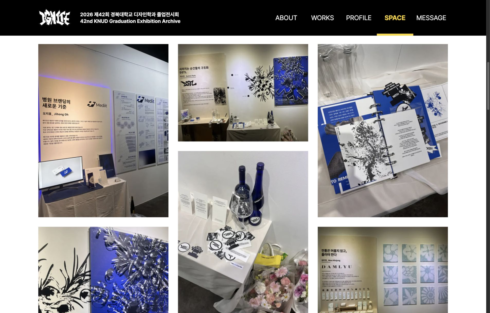
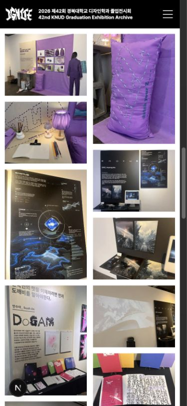
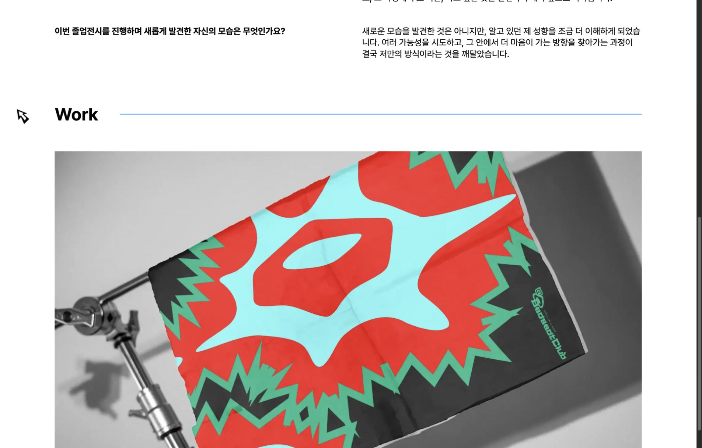
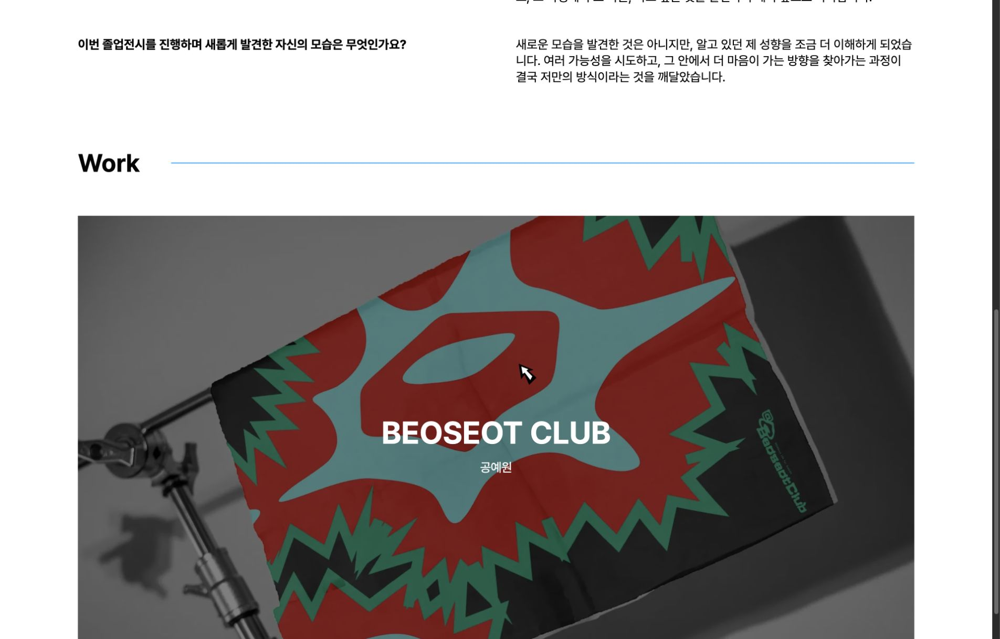
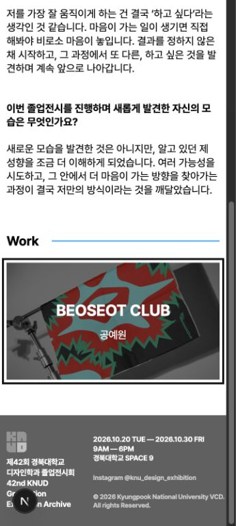

# 10월 12일 디자인 QA

기준: origin/main 93c3504. 작업 브랜치: fix/design-qa-work-archive-profile.
QA 시스템의 완료 상태는 변경하지 않았다. 아래 수정은 디자이너 검토 요청 대상이다.

## QA-001: 작품 소개 간격

- 원인: 작품 소개 문단의 `text-align: justify`가 줄을 채우기 위해 단어 간격을 늘렸다.
- 수정: `text-align: start`. 작성자가 넣은 줄바꿈(`white-space: pre-line`)과 글자 크기는 유지했다.
- 확인: 1920px에서 24px, 390px에서 16px, 두 문단 모두 시작 정렬. 모바일 문단 폭/스크롤 폭은 355px로 같았다.
- 회귀 검사: Work 페이지 테스트 27개 통과.

## QA-002: Archive 로딩

원본 S3 사진 40장은 합계 285,390,964 bytes다. 2번 사진 하나만 9,253,632 bytes이며, 단순 네트워크 차이뿐 아니라 큰 원본을 직접 전송하는 비용이 있었다.

처음에는 S3 원본을 Next Image로 요청 시 변환하는 방법을 확인했다. 단일 1080px 요청은 87,110 bytes로 줄었지만 첫 요청에 5.291초가 걸렸다. 여러 사진을 동시에 요청하자 upstream timeout과 이미지 오류가 발생하여 이 방식만으로는 해결되지 않았다.

최종 수정은 방문 전에 웹용 사본을 준비하는 방식이다.

1. `node scripts/prepare-archive-images.mjs`로 원본을 두 개씩 받아 최대 폭 1600px, sRGB, WebP 품질 85의 사본을 만든다. 원본 파일은 수정하지 않는다.
2. 40장의 원본 URL·규격·용량과 사본 정보를 `src/data/archive-web-images.json`에 기록한다.
3. 실제 `/space`에서 사본을 Next Image의 반응형 `sizes/srcset`으로 제공한다. 원본 URL은 데이터에 유지하고, 전달용 주소만 분리했다.
4. 기존 Masonry와 6장씩 추가되는 방식은 유지한다. 첫 묶음의 선행 요청 범위만 600px에서 1200px로 늘렸다.

웹용 사본 합계는 9,563,972 bytes로 원본 대비 약 96.65% 줄었다. 실제 브라우저는 화면 크기에 맞춰 이보다 작은 변환본을 받는다. 기존 테스트용 40장 데이터이며 새 전시 사진으로 교체할 때도 웹용 사본을 먼저 준비해야 한다. 원본만 추가하면 같은 최적화가 자동 적용되는 것은 아니다.

### 확인 결과와 측정 범위

- 1920×1340: 첫 6장 정상 로딩, 이미지 폭 약 510px, 3열 배치.
- 390×844: 첫 6장 정상 로딩, 이미지 폭 약 171px, 2열 배치.
- 로컬 사본 2번의 1080px/q75 단일 HTTP 요청: 200, 94,019 bytes, 0.073초. 원격 원본 다운로드를 방문 시 수행하지 않는다.
- 위 HTTP 숫자는 서로 다른 입력의 단일 개발 환경 확인이다. 동일 조건 반복 측정이나 Lighthouse 개선율, 배포 성능 수치로 해석하지 않는다.
- Space 테스트 12개 통과. 40장 사본의 실제 파일 크기·규격·비율·순서도 검사했다.

## QA-003: 프로필 Work hover

정확한 작품명·작가명 위치와 어두워지는 hover 상태의 Figma 자료를 기다리는 중이다. 사용자가 자료를 첨부하겠다고 답했다. 기존 프로필 기본 프레임만으로 상태별 규격을 추정하여 수정하지 않았다.

### 영상 수신 후 수정 (10월 12일)

제공된 `화면 기록 2026-10-12 오전 12.56.53.mov`(5.25초)에서 기본 → hover → 해제 상태를 확인했다. 영상 URL에 표시된 Figma `1157:28722`와 내부 Work 기본 컴포넌트 `1157:28374`도 조회했다. 기본 시안은 이미지 위쪽의 별도 작품명이 없고, 영상에서는 어두운 면과 흰색 중앙 작품명이 함께 나타난다.

| 항목 | 적용 기준 |
| --- | --- |
| 기본 상태 | 기존 실제 작품 이미지 유지, 이미지 위 별도 제목 제거 |
| 마우스 진입/해제 | 어두운 면과 중앙 작품명 함께 표시/숨김 |
| 작가명 | 영상에는 없지만 원래 QA 요청에 따라 작품명 아래 추가 |
| 전환 | CSS opacity 180ms ease-out, 검정 50% (영상 기반 조정값, Dev Mode 추출값 아님) |
| 글자 | 기존 Pretendard, 작품명 24–60px·작가명 16–24px 반응형 보간 (검토 대상) |
| 키보드 | focus-visible 시 정보 표시 및 외곽선 |
| 터치 | hover 없이도 작품명·작가명을 볼 수 있도록 정보 표시 유지 |
| 모션 감소 | 전환 제거, 전역 감소 규칙 포함 실제 계산값 약 0초 |

새 JS 상태나 라이브러리 없이 기존 서버 컴포넌트와 CSS로 구현했다. 이미지는 Figma 예시 사진으로 바꾸지 않고 실제 제출 작품을 유지했고, 기존 비율과 링크도 보존했다. 이 작업은 시안 전체의 픽셀 일치 판정이 아니라 기록된 인터랙션 적용이다. 모바일 대체 동작과 작가명 배치는 디자이너 검토 대상이다.

- 1920×1340: 기본 opacity 0, hover 1, 키보드 focus-visible 1 확인.
- 360×800 및 768×1024: 페이지 가로 넘침 없음. 터치 정보 표시 확인.
- 이미지 클릭 시 `/work/1` 이동 확인.
- Profile 테스트 32개, lint·타입 검사·프로덕션 빌드 통과.
- QA 시스템의 상태는 자동 완료하지 않았으며 수정본 검토 요청 대상이다.

