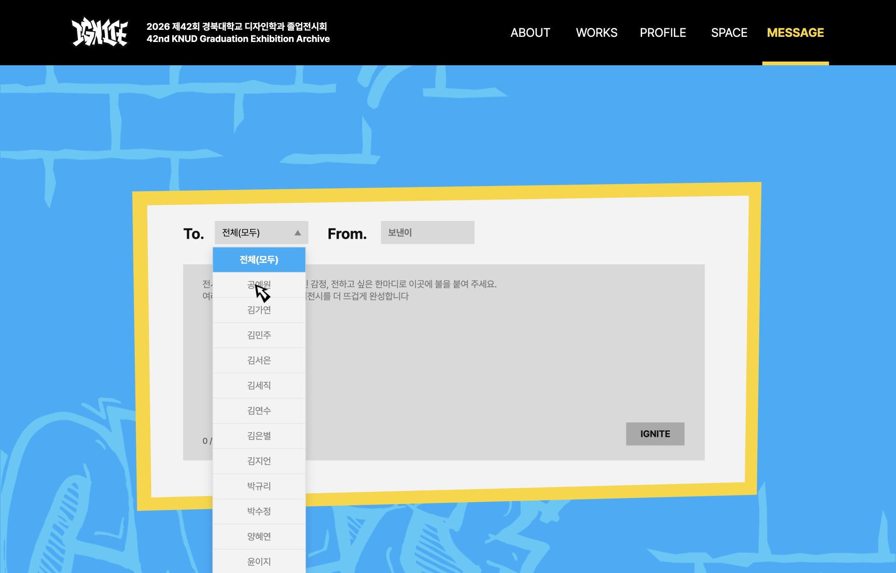

# Message 입력 폼 커서 중복

- QA ID: 756d4ddf-f660-4bc2-8799-0f559415fbf7
- 기준 배포: 93c3504
- 상태: 수정본 검토 요청 대상. 외부 QA 상태를 자동 완료하지 않았다.

## 원인과 수정

Space 수정의 `html.has-custom-cursor *`는 한 클래스 규칙보다 강하지만 `.message-form__body button`과는 우선순위가 같고, 받는 사람 옵션의 후손 선택자에도 밀렸다. 수정 전 실제 1920×1340 화면에서 입력칸은 `none`이나 받는 사람 옵션과 IGNITE는 `pointer`였다. IGNITE의 커서가 `none`이어야 한다는 실제 DOM assertion 실패로 확인했다.

커스텀 커서 모드가 기본 커서를 독점하도록 공통 `cursor: none`에 `!important`를 적용했다. 이 선언은 마우스·hover 지원, 600px 초과, JS의 html 커스텀 모드 클래스 활성 조건에만 적용된다. 모바일이나 커스텀 모드 비활성 환경의 기본 규칙은 변경하지 않는다. 앞선 Space 문서의 `!important` 미사용 설명은 당시 수정 내역이며 이번 보완으로 대체된다.

## 실제 화면 검증

- 드롭다운을 열어 옵션을 포함한 폼 컨트롤 25개 전수 검사: 모두 `cursor: none` 통과.
- 옵션 hover 시 커스텀 커서 opacity 1, 드롭다운 열림 유지 확인.
- 390×844 터치: 커스텀 모드 false, 커스텀 커서 opacity 0, 버튼의 기본 cursor pointer 유지.
- 실제 메시지 작성·전송은 하지 않았다.
- 전체 테스트 154개, lint·타입 검사·프로덕션 빌드·diff 검사 통과.
- 로컬 수정이며 기존 공유 배포에는 아직 반영되지 않았다.

