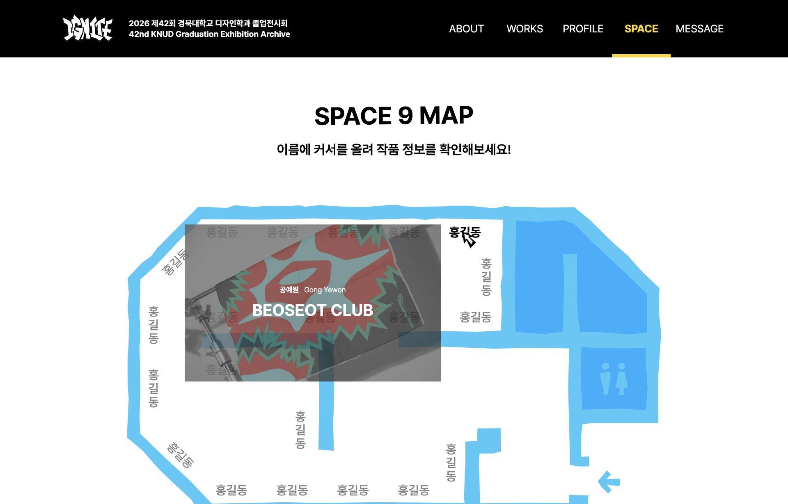

# Space 지도 커서 중복

- QA ID: 0a7c956d-552d-4d93-bf6d-b5c147fc09af
- 기준 배포 SHA: 93c3504
- 수정 브랜치: fix/design-qa-work-archive-profile
- 상태: 수정본 검토 요청 대상. 외부 QA 상태는 자동 완료하지 않았다.

## 원인

공통 `.has-custom-cursor *`와 지도 CSS Module의 `.artist`는 같은 클래스 우선순위였다. 지도 스타일의 `cursor: pointer`가 이겨 링크와 클릭 영역을 확장한 `::before`에서 기본 손 모양 커서가 나타났다. 문자 span 자체는 공통 규칙으로 `none`이어서 글자와 주변에서 동작이 달랐다.

1920×1340 마우스 환경에서 수정 전 계산값을 확인했다: html의 커스텀 모드 활성, 링크 `pointer`, 문자 `none`, `::before` `pointer`. 실제 DOM 검사에서 링크가 `none`이어야 한다는 회귀 assertion이 예상대로 실패했다.

## 수정

공통 규칙을 `html.has-custom-cursor` 및 `html.has-custom-cursor *`로 바꿨다. 한 클래스짜리 컴포넌트 커서 규칙보다 우선하여 CSS 로드 순서에 영향받지 않게 한다. `!important`는 사용하지 않고, 기존 마우스·hover·600px 초과 조건 및 JS 모드 활성 조건은 유지한다. 지도 좌표, hover 작품 정보, 클릭 영역은 변경하지 않았다.

## 실제 화면 확인

- 수정 후 같은 assertion 통과: 링크·문자·`::before` 모두 `none`.
- 데스크톱 지도 링크 21개와 그 문자·가상 클릭 영역 전수 검사 통과.
- 이름 hover 시 작품 정보 펼침 유지, 커스텀 커서 opacity 1 확인.
- 390×844 터치 환경: html 커스텀 모드 비활성, 커스텀 커서 opacity 0 확인. 기본 커서 규칙은 강제 숨김하지 않음.
- 개발 브라우저의 CSS 계산값과 화면으로 검증한 결과이며 아직 기존 배포에 반영된 결과는 아니다.
- 전체 `src/**/*.test.mjs` 테스트 154개, lint·타입 검사·프로덕션 빌드·`git diff --check` 통과.

