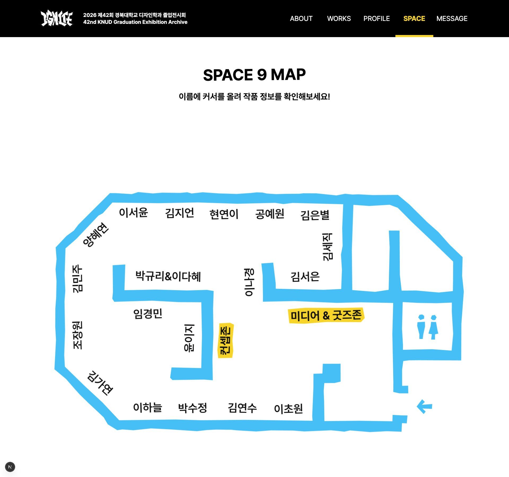
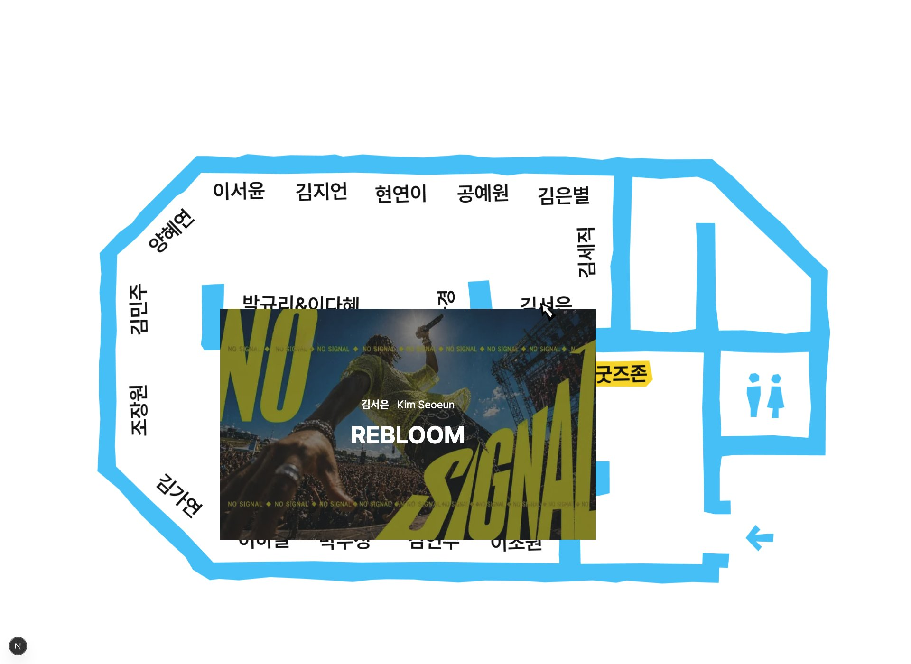
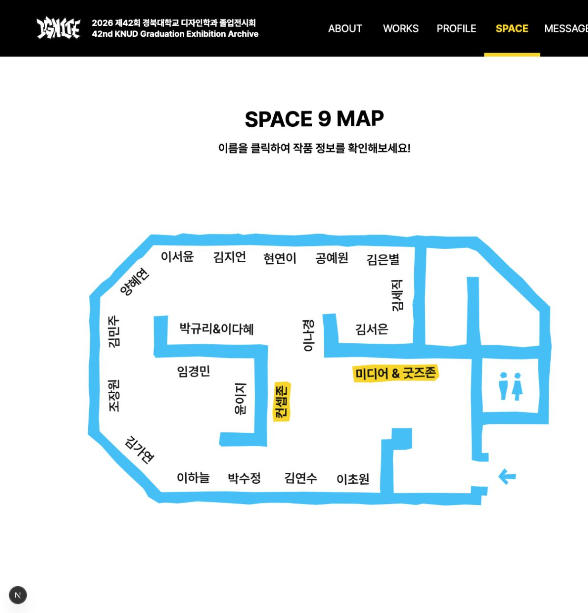
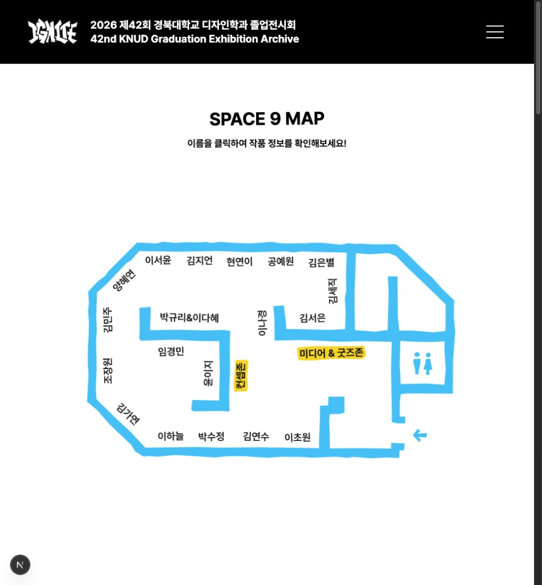
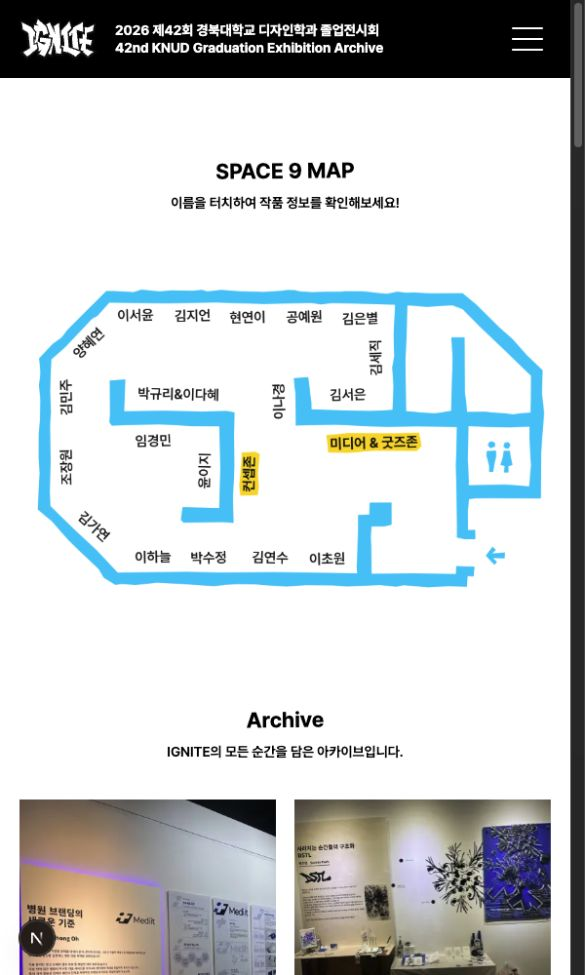
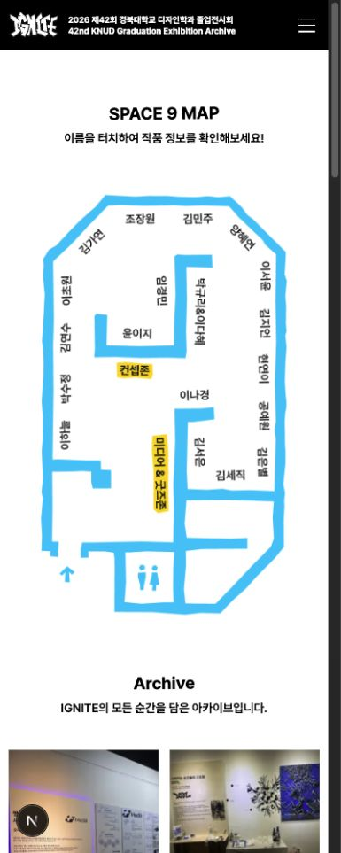
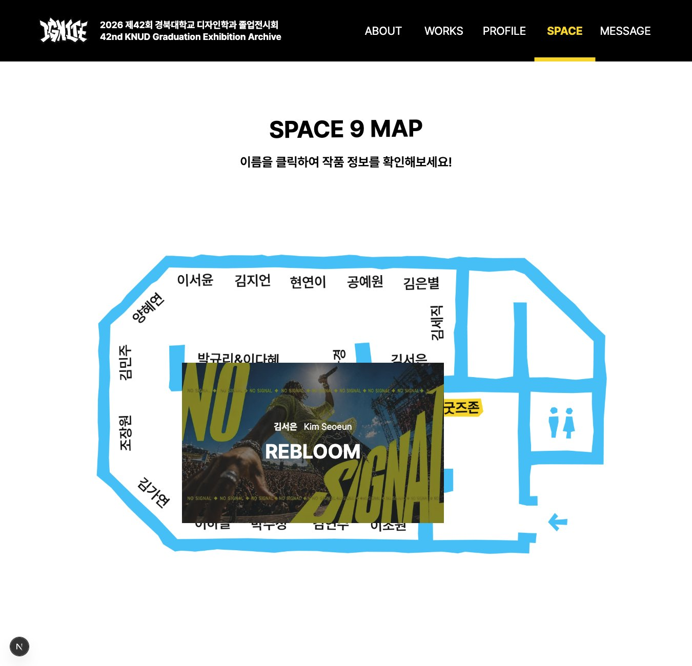
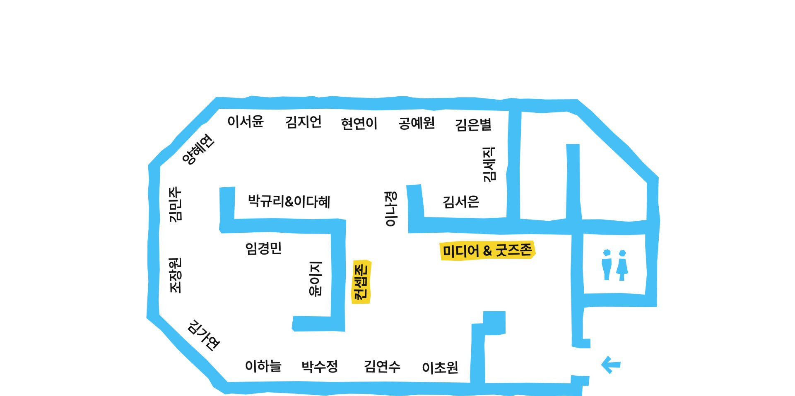

# Space 실제 작가 배치도 반영

상태: 구현 후 검토 요청. 외부 QA 상태는 자동 완료하지 않음.

## 기준

- 자산: Figma `diCbOAaGnNTpLYvfAp1gi8`, `347:164`.
- UI: `L2HN56CFcymI8Is4Ns0lKo`, `2567:9841`, `2567:9946`, `2567:10052`, `2567:10487`, `2567:10593`.
- 자산 파일의 회색 배경 렌더와 달리 실제 UI 프레임은 흰 바탕이다. 최종 화면에는 UI 프레임 내부 지도 `3364:8299`와 모바일 `3369:11053`을 Figma에서 내보낸 PNG로 사용했다. 벡터를 임의로 재작성하지 않았다.
- 가로 지도는 1626×1150, 세로 지도는 384×542 내보내기 결과다. 이 PNG 자체에 표시용 이름과 영역명이 포함된다.

## 구현

- 홍길동 20개와 순번으로 임시 작품을 할당하던 코드를 제거했다.
- 실제 작가 이름으로 작품을 조회한다. 공동 작품 박규리·이다혜는 하나의 부스로 연결하며 총 19개 부스다.
- 컨셉존, 미디어 & 굿즈존 및 모든 작가의 새 배치를 반영했다.
- 표시용 글자는 이미지에서 그대로 보여주고, Figma 이름 영역의 비율 좌표에 접근 가능한 HTML 링크를 배치했다. 화면 크기가 달라져도 지도와 클릭 영역이 함께 축소된다.
- 가로 좌표와 모바일 세로 좌표는 별도 데이터로 유지한다. 단순히 가로 지도를 회전하면 글자 방향이 틀어지는 문제가 있으므로 세로 전용 이미지와 좌표를 사용한다.
- 1920/1350/1020의 지도 폭·제목 아래 간격은 기준 사이를 연속적으로 보간한다. 600은 가로, 400은 세로다. 전환점 480px는 두 제공 프레임 사이의 구현용 기준이다.
- PC 이름 hover/focus의 작품 미리보기, 작은 화면 이름 클릭의 상세 이동과 기존 커스텀 커서 정책을 유지했다.
- 더 이상 사용하지 않는 기존 지도 좌표와 CSS를 제거했다.

## 검증

- 전체 테스트 154개 통과, lint·타입 검사·프로덕션 빌드 통과.
- 두 좌표 목록의 부스 수, 중복, 좌표 범위 및 작가별 작품 연결 테스트.
- 1920, 1350, 1020, 600, 400 CSS px 브라우저 검수: 각 폭에서 표시되는 링크 19개, 가로 넘침 없음.
- PC 김서은 hover 시 `김서은 / Kim Seoeun / REBLOOM` 미리보기 확인.
- 모바일 김서은 이름 클릭 후 `/work/4` 이동 확인.
- OS 스크롤바 15px가 콘텐츠 폭에서 제외되므로 Figma 고정 프레임과 몇 px 차이가 있다. 모든 픽셀의 동일성을 주장하지 않으며 캡처를 기준으로 디자이너 검토를 요청한다.
- PNG의 고밀도 화면 선명도는 원본 내보내기 해상도에 제한된다. 벡터/2배 export 제공 시 동일 좌표 구조로 대체할 수 있다.

## 화면

## 후속 검수: hover와 클릭 이동 복원

- 사용자 확인 후, 1350px에서 미리보기가 안 뜨는 것과 PC 클릭이 상세로 이동하지 않는 것을 실제 브라우저에서 재현했다. 기존 `min-width: 1350.0625px` 조건과 클릭의 `preventDefault()`가 원인이었다.
- 지도 hover는 822px 이상에서 마우스 hover가 가능한 fine pointer에 제공한다. 1350px 및 마우스가 있는 1020px 화면에서도 작품 미리보기가 열린다. 터치·작은 모바일은 클릭으로 바로 이동한다.
- 링크 클릭을 가로채던 핸들러를 제거해 모든 화면에서 작가의 `/work/:id`로 이동한다. Ctrl/Cmd 클릭 등 기본 링크 기능도 유지한다.
- 미리보기 이미지 `sizes`의 작은 화면 0px 조건도 821px 이하로 조정해 중간 폭에서 미리보기 화질이 과도하게 축소되지 않게 했다.
- 회귀 확인은 실제 브라우저 UI에서 실패 → 수정 → 성공 순서로 진행했다. 1350px hover의 `data-open` 값은 수정 전 false, 수정 후 true였다. PC 클릭 URL은 수정 전 `/space`, 수정 후 `/work/4`였다.
- 추가 확인: 1920px 공동 작품 클릭 `/work/9`, 1020px 마우스 hover, 400px 김서은 클릭 `/work/4`.
- 전체 테스트 154개, lint, 타입 검사, 프로덕션 빌드 및 diff 검사 통과. 클릭을 막도록 요구하던 구형 소스 검사 2개는 제거했다.

## 후속 검수: 큰 PC 화면의 지도 크기 축소

- 사용자 첨부 QA 화면은 1920×1340 프레임을 50%로 표시하고, 이전 SHA `93c3504` 지도를 보여주고 있었다. 실제 브라우저 100% 화면과는 배율·버전·화면 높이가 모두 다르다.
- 새 지도 적용 당시 가로 폭을 약 1620px까지 확장한 것도 커 보이는 원인이었다. 사용자의 승인에 따라 새 디자인·비율·작가 배치는 유지하고 PC 지도 최대 폭만 이전 1302px로 제한했다.
- 1350px의 지도 폭 1032.818px는 유지하며, 1920px까지 완만하게 보간한다. 1350px 미만과 모바일 지도 규칙, 공통 헤더·글자 크기·다른 페이지는 수정하지 않았다.
- 실제 1920×958 CSS 뷰포트 측정: 변경 전 1605×1135.14px → 변경 후 1302×920.84px. 새 지도 종횡비는 유지하므로 이전 지도 높이 762px로 강제 압축하지 않는다.
- 브라우저 크기 검사 실패(1605px) → 수정 후 성공(1302px) 확인. 1350px에서는 1032.81×730.45px, 400px에서는 기존 세로 지도와 작가 링크 19개를 유지하고 가로 넘침이 없었다.
- 축소한 지도에서 김서은 hover 미리보기와 클릭 `/work/4` 이동을 다시 확인했다. 미리보기 이미지 sizes도 최대 표시 폭 약 637px에 맞췄다.
- 전체 테스트 154개, lint, 타입 검사, 프로덕션 빌드 및 diff 검사 통과.

