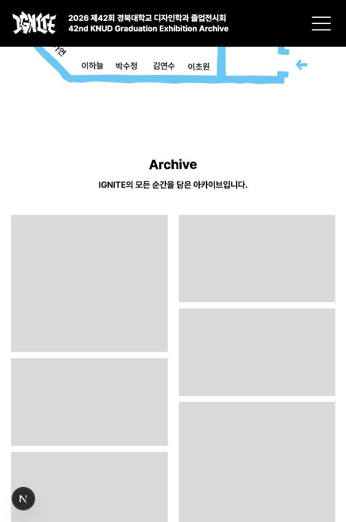

# Archive 테스트 사진 표시 제거

## 요청

작년 전시 사진은 로딩·레이아웃 테스트용이므로 실제 SPACE 화면에서 제거하고, 이전의 기본색 패널 레이아웃으로 되돌린다.

## 반영

- SPACE의 ArchiveGallery 연결을 제거하고 서버 렌더링되는 정적 패널로 복원한다.
- 기존 `archiveColumns`의 높이와 열 폭 비율을 사용한다. 기본색 `#d9d9d9`, 간격, PC 3열·821px 이하 2열을 유지한다.
- 빈 패널은 로딩 중 이미지가 아닌 장식 요소이므로 접근성 트리에서는 숨긴다. Archive 제목과 소개는 유지한다.
- 운영 Archive 영역에는 이미지·블러·프리로드·무한 스크롤을 생성하지 않는다.
- 독립 성능 실험 코드와 그 테스트용 원본·최적화 자산은 삭제하지 않는다. 기존 실험을 재현할 수 있게 두며 실제 SPACE 화면에서는 사용하지 않는다.
- 지도와 작품 미리보기, GA·Clarity, 예약 공개 설정은 변경하지 않는다.

## 로컬 검증

- 전체 테스트 197개, lint, type-check, production build, `git diff --check` 통과.
- 브라우저에서 1920·1350·1020px의 3열, 600·400·320px의 2열을 확인했다. 모든 규격에서 Archive 이미지 요소 0개와 가로 넘침 없음을 확인했다.
- 운영 배포는 진행하지 않았다. 기존 이미지 파일은 유지되며, 이번 변경은 실제 SPACE 화면에서 테스트 사진 연결을 제거하는 범위다.

