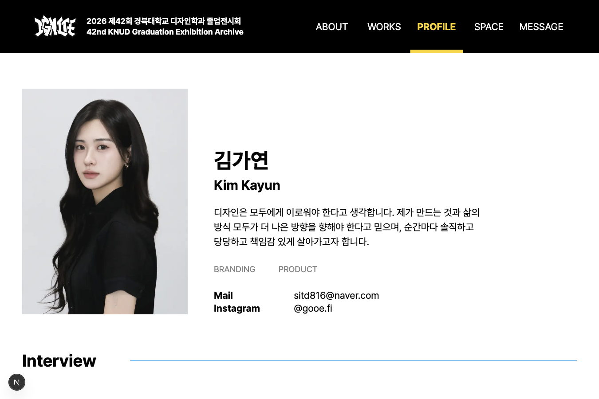
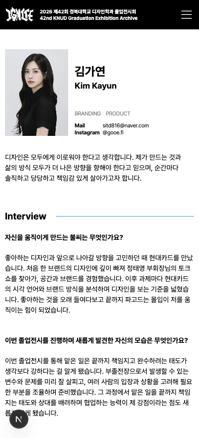

# 프로필 상세 타입 스케일과 자기소개 폭 조정

## 요청과 해석

- 프로필 상세의 글자를 전반적으로 조금 줄인다.
- 자기소개가 오른쪽 끝까지 이어지지 않도록 사진 오른쪽 텍스트 영역 폭의 약 2/3에서 줄바꿈한다. 전체 페이지 폭의 2/3 위치에 고정하는 의미로 구현하지 않았다.
- 작가 20명의 실제 데이터에서 줄바꿈 증가로 레이아웃이 깨지는 사례가 있는지 확인한다.

## 반영

- `profile-detail--compact` 범위의 CSS 변수로 이름·소개·분야·연락처·섹션 제목·인터뷰·Work 오버레이 글자 크기를 조정한다. 사진과 컨테이너는 그대로 유지한다.
- 1920px: 국문 이름 80→72px, 영문 이름 48→42px, 소개·연락처 24→20px, 분야 20→18px, 인터뷰 20→18px, 섹션 제목 48→40px.
- 1020px: 국문 이름 50→44px, 영문 이름 30→27px, 소개 22→18px, 분야 18→16px, 인터뷰 16→15px.
- 모바일 소개·인터뷰는 최소 14px을 유지한다. 이미 작게 맞춘 모바일 연락처는 더 줄이지 않는다. 이름과 섹션 제목만 한 단계 낮춘다.
- 1020px 초과에서만 자기소개 `max-width: 66.6667%`를 적용하고, 이하에서는 `100%`를 사용한다.
- 소개 원문을 수정하거나 생략하지 않는다. 고정 높이·line-clamp를 추가하지 않고 문서 흐름으로 높이가 늘어나게 한다. 단어 우선 줄바꿈과 긴 문자열 안전 개행, 행간 1.5를 적용한다.
- 헤더·푸터·목록 카드·연락처 순서·Work hover 동작·키보드 초점은 유지한다.

## 실제 브라우저 검증

- 20명 × 9개 폭 = **180개 조합**. 폭은 1920·1350·1020·768·600·460·400·360·320px이다.
- 소개와 사진·이름·연락처 사이의 사각형 겹침, 소개 높이 잘림, 인터뷰 제목 침범, 페이지 가로 넘침, 소개·이름·연락처·분야 내부 가로 넘침을 검사했다. **발견 0건**.
- 현재 가장 긴 소개는 이초원(114자)이다. 1920px에서는 오른쪽 영역 1002px 중 소개 668px, 1350px에서는 818px 중 545px을 사용하며 둘 다 3줄이다. 1020px에서는 오른쪽 영역 557px 전체를 사용하며 3줄이다.
- 1920px에서 모든 소개는 2~3줄, 320px에서 가장 긴 소개도 4줄로 표시됐다. 긴 글에 맞춰 소개 영역 높이가 늘어나며 인터뷰는 그 아래에 놓인다.
- 김가연의 1350px PC·400px 모바일 화면을 캡처해 사진·소개·연락처·인터뷰의 배치와 위계를 확인했다.
- 이 결과는 현재 등록된 20명의 원문 기준이다. 향후 더 긴 내용은 높이가 늘어날 수 있지만, 고정 높이로 잘리도록 구현하지 않았다.
- 전체 테스트 198개, lint, type-check, production build, `git diff --check` 통과.
- 검수 예외: 분야의 기존 `#848484` 회색은 흰 배경에서 약 3.74:1로 일반 텍스트 권장 대비 4.5:1에 못 미친다. 기존 색상 보존을 위해 이번 글자 크기 요청에서는 바꾸지 않았다. 본문은 기존 검정색을 유지한다. 이 검수로 페이지 전체 접근성 적합성을 보장하지 않는다.

최초 로컬 검토 시점에는 커밋·배포하지 않았다. 후속 요청으로 Archive와 Profile 변경을 기능·테스트·문서 단위의 별도 커밋으로 정리해 PR을 생성한다. main 병합·운영 배포는 이번 요청 범위가 아니다.

## 후속 피드백 — 중간 크기로 소폭 확대

- 첫 축소안이 너무 작다는 요청으로 사진·여백·소개 폭은 그대로 두고 글자만 중간 크기로 키웠다. 위 수치는 첫 축소안의 검증 기록이며, 현재 값은 DESIGN.md의 최신 규격을 따른다.
- PC 소개·연락처 20→22px, 인터뷰 18→19px, 큰 PC 이름 국문 72→76px·영문 42→45px로 조정했다. 태블릿 소개는 18→20px, 인터뷰는 15→16px이며 모바일 소개·인터뷰는 14px을 유지한다.
- 같은 20명 × 9개 폭(180개 조합)을 다시 검사했고 잘림·겹침·가로 넘침은 발견되지 않았다. 소개의 2/3 폭 제한 및 작은 화면 전체 폭 규칙도 유지된다.

## 최신 피드백 — 글자 크기 대신 소개 폭 확대

- 요청 의도를 소개 영역의 오른쪽 확장으로 확인하고 글자 크기는 그대로 유지했다. PC 소개 `max-width`만 약 67%에서 75%로 넓혔다. 1020px 이하 전체 폭도 유지한다.
- 김가연 소개는 1920px에서 751px, 1350px에서 614px로 표시된다. 글자 크기는 소개 22px·인터뷰 19px로 이전 보정안과 같다.
- 전체 20명 × 9개 폭(180개 조합)을 다시 검사했고 잘림·겹침·가로 넘침은 발견되지 않았다. PC 캡처로 문단의 오른쪽 끝이 더 멀어지는 것을 확인했다.

## 최종 화면 자료

## 추가 요청 — 이름만 축소

- 큰 PC 이름은 국문 76→64px·영문 45→38px, 1350px에서는 57→48px·36→30px로 줄였다. 태블릿은 40px·24px, 600px 이하는 28px·19px, 460px 이하는 24px·17px을 사용한다.
- 소개 폭 75%, 소개·연락처·인터뷰 글자 크기, 사진 및 다른 배치는 변경하지 않았다. 위 PC·모바일 캡처도 이름을 줄인 최신 화면으로 갱신했다.
- 현재 작가 20명 × 9개 폭(180개 조합)에서 잘림·겹침·가로 넘침이 발견되지 않았다. 이름 위계와 PC·모바일 배치를 확인했다.
- 전체 테스트 199개와 lint·type-check·production build·diff 검사를 통과했다.
- 후속 요청에 따라 스타일·테스트·검수 기록을 별도 커밋으로 분리하고 기존 PR #40 브랜치에 추가한다. main 병합·운영 배포는 진행하지 않는다.
