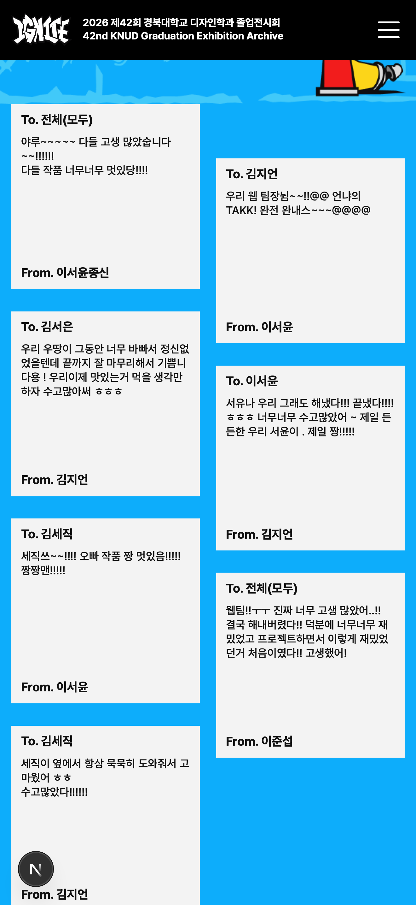

# MESSAGE Safari 작성자 잘림 핫픽스

- 브랜치: `hotfix/message-sender-clipping`, 기준 main `6901181`.
- 사용자 승인: 모바일 잘림 수정 후 커밋·PR·main 병합·운영 배포. 지도는 원인 분석만 수행한다.

## 원인과 변경

- Chromium에서는 재현되지 않았지만, 별도 승인으로 실행한 Playwright 1.55 / WebKit 26.0에서 재현했다. 실제 iPhone 기기를 직접 연결한 검증은 아니다.
- 비율로 높이가 정해진 카드 안의 `height: 100%`가 일부 WebKit에서 패딩을 포함한 카드 전체 높이로 계산됐다. From. 하단이 400px 폭에서 카드 아래 약 8.78px, 1920px에서 약 27px로 내려갔다. 본문이 짧아도 발생했다.
- 부모 카드를 세로 Flex로 만들고, 내용은 `flex: 1; height: auto; min-height: 0`으로 남는 내부 공간에 배치한다. 모바일의 100% 높이 재지정도 제거한다.
- 카드 외곽 규격, 패딩, 글자 크기·행간·자간, 100칸 한도, 2열·엇갈림 배치와 개인정보 마스킹은 변경하지 않는다. DB 조회 이외의 테스트 메시지 쓰기는 하지 않았다.
- 기존 검증은 본문·copy 영역의 잘림과 From.과의 겹침에 집중해 카드 외곽의 작성자 하단 경계를 놓쳤다. 이번 검증은 패딩을 제외한 내부 경계까지 직접 검사한다.
- 관련 엔진 동작 참고: [WebKit STP 243 CSS 수정 기록](https://webkit.org/blog/17953/release-notes-for-safari-technology-preview-243/)에는 aspect-ratio 부모와 자식의 100% 높이 계산 관련 수정이 기록되어 있다. 이번 원인 판단의 직접 근거는 로컬 WebKit 재현·실측이다.

## 검증

- 수정 전 WebKit: 기존 공개 카드 7건 × 33개 폭 = 231건 검사에서 189건이 작성자 하단 경계 검사에 실패했다.
- 수정 후 WebKit·Chromium: 엔진별 429건, 총 858건 통과. 공개 카드 7건과 임시 DOM 표본 6종을 33개 폭에서 확인했다.
- 표본: 짧은 글, 한글 100자, W 100자, 줄바꿈 4개 포함 100칸, 공백 있는 자연어 100자, 한글 40자+줄바꿈+40자. 표본 작성자는 한글 20자다.
- 폭: 320, 360, 375, 390, 393, 399, 400, 412, 414, 428, 430, 440, 480, 481, 600, 601, 700, 701, 768, 820, 821, 822, 1019, 1020, 1150, 1350, 1439, 1440, 1512, 1600, 1799, 1800, 1920px.
- From./내용 컨테이너의 하단이 카드 패딩 안에 있는지, 본문·copy·작성자 잘림과 가로 넘침, 본문-From. 간격 7px 이상, 모바일 2열을 확인한다. 440px WebKit의 실제 카드 7건 모두 하단 여백 약 8.80px를 확보했다.
- 전체 테스트 208개, lint, type-check, production build, diff 검사 통과. WebKit 검증은 별도 실행한다.
- 재현 스크립트: `scripts/qa/check-message-layout.mjs`. Playwright WebKit이 설치된 별도 QA 런타임의 `index.mjs` 경로를 `PLAYWRIGHT_MODULE_PATH`로 주고 실행한다. 프로젝트 번들·의존성은 추가하지 않았다.

```sh
PLAYWRIGHT_MODULE_PATH=/absolute/path/to/playwright/index.mjs \
  node scripts/qa/check-message-layout.mjs
```

- `MESSAGE_LAYOUT_BASE_URL`은 기본 `http://localhost:3000`이다. 운영 도메인으로도 읽기 전용 검증할 수 있다. 임시 표본은 해당 검증 브라우저에만 추가되며 종료 시 제거된다. 등장 애니메이션 종료 후 표본을 추가해 React 재조정으로 표본이 사라지지 않게 한다.
- 승인된 WebKit 설치 과정에서 Playwright가 미사용 Chromium 1228·headless 1228 바이너리 캐시를 자동 정리했다. 사용자 브라우저 프로필·데이터는 변경하지 않았으며 해당 바이너리는 재다운로드할 수 있다.

## 지도 흐림 분석 (수정하지 않음)

- 모바일 원본: `public/assets/figma/space/map-assigned-mobile-2026.png`, 384×542px PNG. 데스크톱 원본은 1626×1150px다.
- 운영에서 받은 모바일 PNG와 저장소 원본의 SHA-256이 동일했다. `next/image`의 `unoptimized`로 직접 제공되고 있어 별도의 화질 축소는 없었다.
- 440px 화면에서 실제 표시 폭 416 CSS px, DPR 3 기준 필요한 가로 픽셀은 1248px다. 384px 원본을 확대 표시하는 것이 주된 선명도 한계다. 이미지 필터는 `none`, opacity는 1이다.
- 이름과 세부 선을 유지한 SVG, 또는 같은 그림의 4× 내보내기(1536×2168px)를 다시 받는 편이 적합하다. 현재 384px 파일을 단순 확대하는 것으로 원래 세부를 복원할 수는 없다. 지도 파일·좌표·링크는 이번 핫픽스에서 건드리지 않는다.

## 화면


