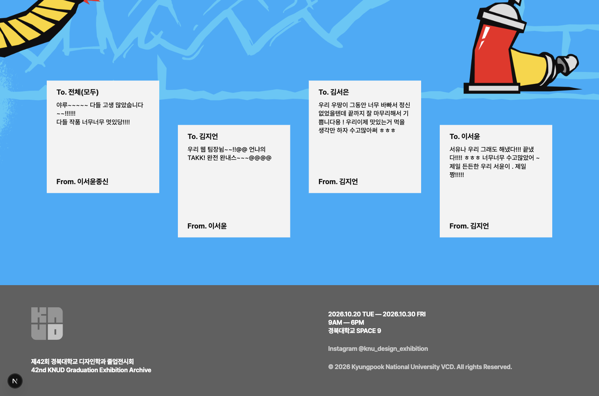
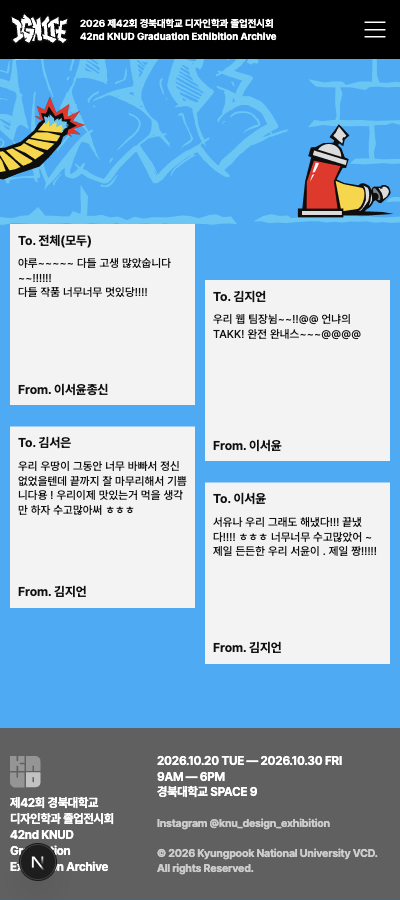
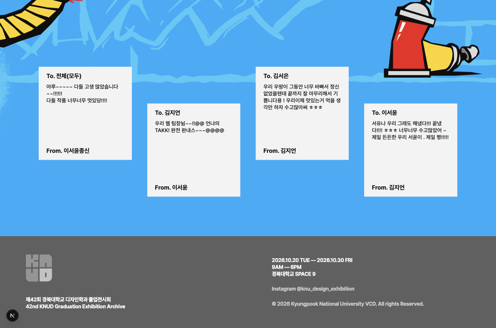
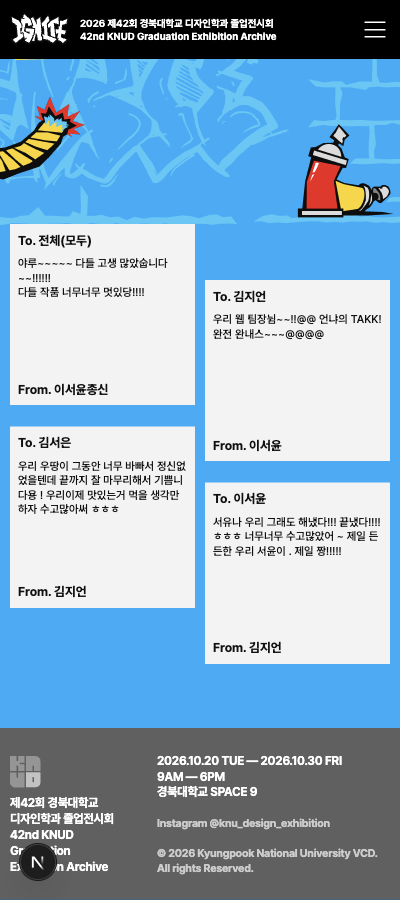
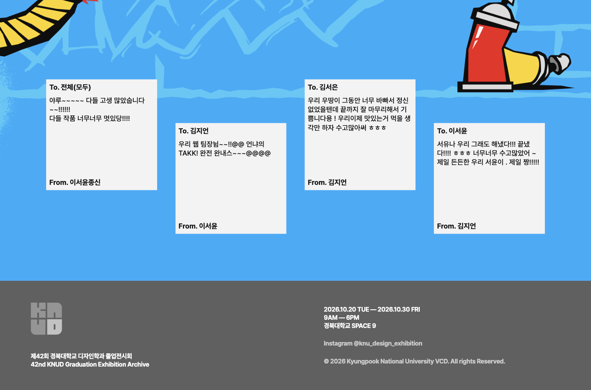
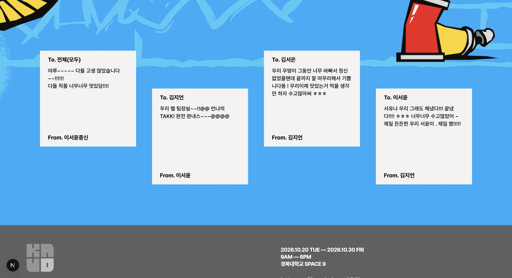
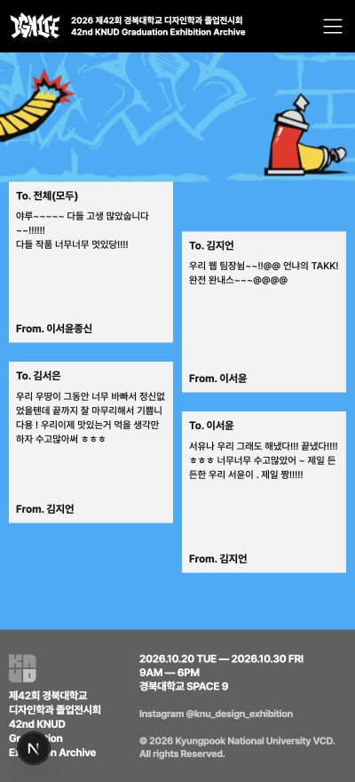
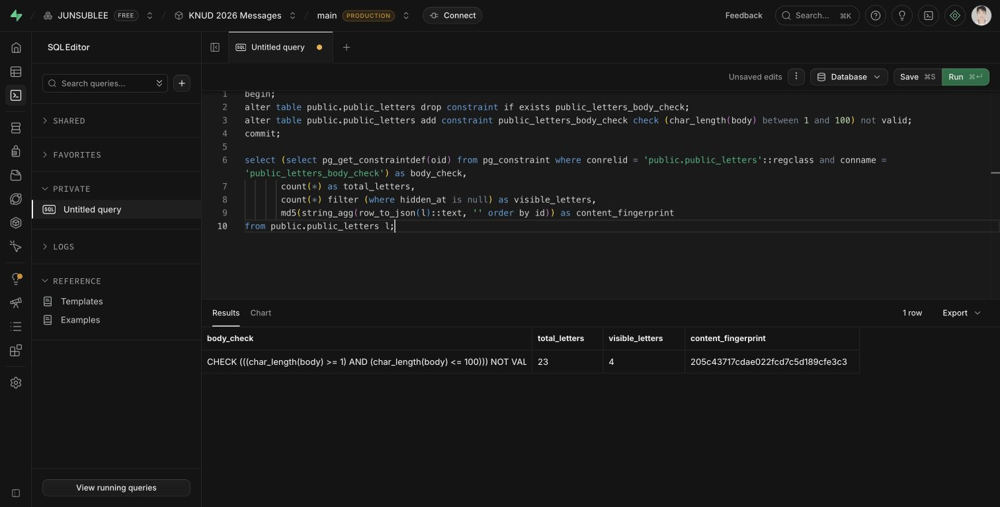

# MESSAGE 100자·본문 여백 검토

- 상태: 개발환경 검토를 거쳐 2026-10-20 사용자가 운영 배포를 승인했다. 아래 화면·DB 검증은 릴리스 전 기록이며 실제 배포 결과는 연결된 PR에서 확인한다.
- 목적: 실제 짧은 편지의 과한 빈 공간을 조금 완화하고 본문 가독성을 높인다. 동일한 포스트잇 규격과 모바일 2열은 유지한다.

## 반영

- 입력 정규화·카운터·서버 검증의 공통 한도를 90에서 100으로 늘렸다. 줄바꿈은 기존과 같이 20칸으로 계산한다.
- 본문 자간을 `-0.002em`에서 `0.01em`으로 조정했다. 최초 검토에서는 글자 크기를 유지하고 행간만 1.45로 늘렸으나, 후속 요청으로 본문과 To./From.도 키웠다.
- 글자 확대 검토 버전에서는 본문을 PC 15%, 태블릿·모바일 5~8% 확대하고 내부 패딩을 줄였으나, 사용자가 여백 소실과 과한 본문 크기를 지적했다. 이 버전은 아래 화면 자료에서 이전 검토안으로만 보존한다.
- 여백 복원 검토안: 상하좌우 패딩을 확대 전 규격으로 복원하고 본문 확대율을 PC 3%, 태블릿·모바일 0%로 낮췄다. 확대 검토안보다 PC 약 10.4%, 모바일 약 4.8~7.4% 작다. To./From.의 PC 10%, 태블릿·모바일 5~8% 확대는 유지한다.
- 예: 1920px에서 본문 21.85→19.57px, To./From. 22px 유지. 400px에서 본문 11.55→11px, To./From. 12.6px 유지. 1512px에서 내부 패딩은 8px에서 세로 15.8px·가로 약 23.5px로 복원된다.
- 포스트잇 외곽 크기·작성자 하단 정렬·모바일 2열은 유지한다. 행간은 기본 1.45, 좁은 카드 구간(700px 이하와 1440~1799px)은 1.3으로 적용한다. 짧은 글에는 여전히 여백이 남는다.
- 본문 최대 높이는 같은 행간 변수를 사용한다. 400~480px의 기존 7줄 생략 제한은 제거해 확대 후 100자 본문이 임의로 잘리지 않도록 했다.

## 중간값 소폭 확대 (현재)

- 여백 복원 후 사용자가 공간이 비어 보인다며 본문·자간·행간·여백의 소폭 확대안을 승인했다. 기존 상하좌우 패딩은 줄이지 않는다.
- 본문 크기는 복원안 대비 일반 PC 약 1.94%, 태블릿·모바일 2% 확대했다. 1920px 기준 19.57→19.95px, 400px 기준 11→11.22px다. To./From.과 외곽 규격·100칸 입력 한도는 그대로다.
- 자간은 0.01→0.012em으로 늘렸다. 일반 구간은 같은 행간 배율에서 글자 크기 증가에 따라 실제 줄 높이도 증가한다. 1440~1919px의 조밀한 4열 구간은 100자 본문을 보존하도록 글자 크기를 유지하고, 1440~1799px 행간 배율만 1.3→1.32로 늘렸다.
- 481px 이상 내부 패딩을 각 방향 1px씩 늘렸다. 480px 이하에서는 최대 본문과 긴 작성자명을 수용하기 위해 기존 패딩을 유지한다. 최초의 일괄 3% 확대·행간 0.05 증가안은 일부 최대 길이 표본이 잘려 적용하지 않았다.
- 위의 29개 폭 × 5종 본문 × 20자 작성자명 145개 조합을 실제 CSS로 다시 검사했다. 본문·copy 잘림, 작성자 가로 넘침, 본문-From. 간격 7px 미만인 조합은 없었다. 실제 공개 메시지 4건의 1512/400px 화면을 확인하고 임시 표본·폭 에뮬레이션을 제거했다.
- 전체 테스트 208개, lint, type-check, production build, diff 검사를 다시 통과했다. DB 데이터·운영 배포는 변경하지 않았다. 짧은 글이 남기는 빈 공간은 고정 카드 규격의 의도된 동작이다.

## 브라우저 검증

- 폭: 320, 360, 375, 390, 400, 430, 480, 600, 601, 768, 820, 1019, 1020, 1150, 1350, 1439, 1440, 1512, 1920px.
- 한글 연속 100자, 영문 W 100자, 줄바꿈 4개 포함 100칸, 공백 있는 자연어 100자, 한글 40자+줄바꿈+40자의 5종을 실제 카드 DOM에 임시 복제해 95개 조합을 측정했다.
- 본문 및 copy 영역의 `scrollHeight`와 `clientHeight`, From.과의 간격을 검사해 잘림·겹침이 없음을 확인했다. 400px의 가장 긴 영문 표본도 From. 위 간격이 약 14.7px 남았다.
- 위 95개 조합은 최초 행간 조정의 기록이다. 글자 확대 후에는 399, 481, 500, 650, 700, 701, 1600, 1601, 1799, 1800px 경계를 추가한 총 29개 폭에서 같은 본문 5종과 20자 한글 작성자명으로 145개 조합을 다시 측정했다.
- 확대 후 본문·copy 잘림, 작성자명 가로 넘침, 본문과 From. 사이 간격 7px 미만인 조합이 없었다. 카드 외곽 크기는 기존과 동일했다. 실제 공개 메시지 4건의 데스크톱·모바일 화면도 확인했다.
- 패딩 복원·본문 축소 후 같은 145개 조합을 다시 확인해 동일한 잘림·겹침 검사를 통과했다. 1512px에서 패딩 복원 및 본문 축소 조건이 변경 전에는 실패하고 변경 후 통과하는 것도 실제 계산 스타일로 확인했다. 전체 테스트 208개, lint·type-check·production build·diff 검사를 다시 통과했다.
- 임시 DOM 표본과 화면 폭 에뮬레이션을 제거하고 실제 공개 메시지와 원래 브라우저 폭으로 복원했다. 검증 편지를 DB에 게시하지 않았다.
- 100자 보존·101자 차단·줄바꿈 가중치 경계의 회귀 테스트를 먼저 실패시킨 뒤 통과시켰다. 전체 테스트 208개, lint·type-check·production build·diff 검사 통과.

## 공용 DB 적용

- 사용자가 별도로 공용 DB 제한 변경을 승인했다. 조회 결과 실제 DB에는 과거 150자 제약이 남아 있어 100자 제약으로 통일했다.
- `20261020000100_expand_public_letter_body_to_100.sql`과 동일한 DDL을 로그인된 Supabase 관리자 SQL Editor에서 트랜잭션으로 실행했다. `NOT VALID`로 기존 행을 재작성하지 않고 신규 쓰기에 1~100자를 적용한다.
- 변경 전후 전체 23건·공개 4건이 동일하고 전체 행의 정렬된 JSON 지문도 `205c43717cdae022fcd7c5d189cfe3c3`으로 동일했다. 본문·작성자·수신자·작성 시각·숨김 상태는 변경하지 않았다.
- 실제 DB 제약 `char_length(body) <= 100`을 재조회했다. 테스트 메시지 저장은 하지 않았다. 이 DB 조치 당시 운영 앱은 90자 입력 UI/서버를 사용했으며, 이번 코드 릴리스에서 운영 앱도 100칸으로 통일한다. 배포 시 DB DDL은 재실행하지 않는다.
- 코드 롤백과 DB 롤백은 별개다. 이 작업의 코드·마이그레이션 파일을 되돌려도 이미 반영된 DB 제약이 자동 복원되지는 않는다.

## 화면 자료

### 중간값 소폭 확대 (현재)

### 여백 복원·본문 크기 재조정 (이전 검토안)

### 글자 확대·패딩 축소 (이전 검토안)

### 최초 행간 조정

