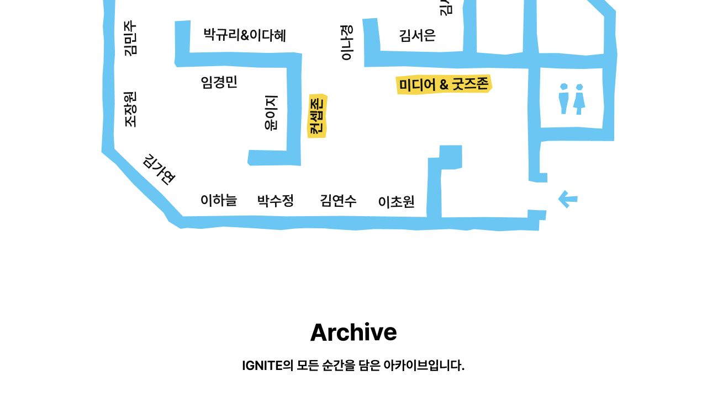
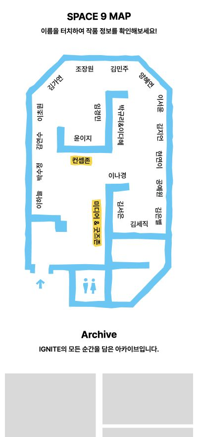

# 대형 모니터 비례 확장 및 SPACE 지도 간격

## 요청과 범위

- 1920px를 넘는 화면에서 About·Message의 아트워크 끝에 생기는 빈 영역을 제거한다.
- 1920px 이하 기존 구성은 유지하되 SPACE 제목→지도, 지도→Archive 간격은 모든 화면에서 줄인다.
- 지도 원본 SVG, 작가별 링크, hover 미리보기와 MESSAGE 작성자 영역을 보존한다.
- `fix/ultrawide-layout-space-spacing` 브랜치에서 작업했다. 후속 커밋·병합·배포 상태는 PR과 Vercel 기록을 기준으로 확인하며, 디자인 QA 최종 확인은 별도 검토로 남긴다.

## 원인과 변경

수정 전 2560px 브라우저에서 Committee 패널의 오른쪽 끝은 1920px였다. Message 장식 배경은 1918px에 제한되어 좌우 321px이 남았다.

1920px 초과 화면에서는 About의 프레임·패널·타이포그래피·캐러셀을 같은 기준 비율로 확장한다. Message 배경은 화면 전체 폭을 채우고 입력 프레임·메시지 목록·포스트잇도 기준 비율을 유지한다. SPACE의 콘텐츠와 지도 역시 1920px 이후 비례 확장한다. 읽기 폭 등 다른 페이지의 의도적인 최대 너비는 변경하지 않았다.

확장된 About 포스터·단체 사진·SPACE hover 이미지에는 실제 표시 폭에 맞는 `sizes`를 지정한다. 기존 포스터 크기를 고정 문자열로 검사하던 테스트의 기대값도 이 규격에 맞췄다.

지도 간격은 다음과 같이 줄였다. 표의 간격은 SVG 자체 여백을 제외한 CSS margin이다.

| 화면 폭 | 제목→지도 이전/이후 | 지도→Archive 이전/이후 |
| --- | --- | --- |
| 400px | 40 / 20px | 60 / 32px |
| 600px | 40 / 24px | 80 / 36px |
| 1920px | 220 / 80px | 330 / 120px |

## 브라우저 검증

로컬 Chromium의 실제 DOM·computed style·요소 경계를 측정했다. 개발 서버뿐 아니라 `next build` 후 `next start`의 최적화 빌드에서도 검사했다.

- 폭: 360, 400, 600, 768, 1020, 1350, 1920, 1921, 2560, 3440px.
- About·Message·SPACE의 30개 조합에서 문서 가로 넘침 없음.
- 1921·2560·3440px에서 Committee 패널이 오른쪽 끝에 도달함(오차 0.01px 이하), Message 장식 배경 폭이 뷰포트와 동일함.
- PC 지도: 822, 1020, 1350, 1920, 2560, 3440px에서 각 작가 링크를 화면 안으로 스크롤한 뒤 실제 마우스 hover. 19명 × 6폭 = 114개 미리보기가 열리고 화면 가로 경계와 Archive를 침범하지 않음. Archive까지 최소 50px 확보.
- MESSAGE: 실제 저장된 메시지 14개 × 10폭에서 From 영역의 카드 하단·우측 넘침 없음. 테스트 메시지 쓰기나 데이터 변경 없음.
- 모바일 400px에서 양혜연 이름 클릭 → `/work/11` 이동 확인.
- 기본 PC 뷰와 400px 모바일의 지도→Archive 간격 캡처 확인.

별도 코드 리뷰에서 발견한 캐러셀 이미지의 고정 `690px` 슬롯은 대형 화면용 `35.9375vw`로 보완했다.

### 검수 화면

PC 1280px의 지도→Archive 간격:

모바일 400px의 세로 지도와 Archive:

## 자동 검증과 남은 확인

- 전체 테스트 212건 통과.
- lint, type-check, production build, `git diff --check` 통과.
- 네이티브 Safari 및 실제 전시장 모니터의 육안 검수는 미실시. 기존 Safari용 카드 flex 높이 보정은 변경하지 않았다.
- 위 검증은 로컬 구현·최적화 빌드 기준이다. 운영 반영 여부와 별개로 디자이너 검토가 필요하다.
