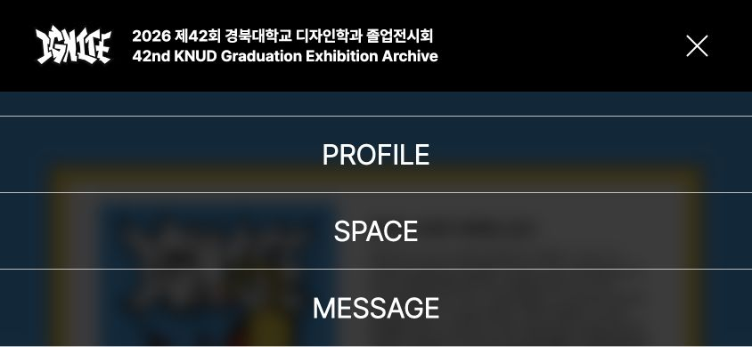

# 모바일 메뉴 높이와 PC 전환 검수

- 상태: 검토 요청, 디자이너 확인 전
- 기준: main `3e76633` → `fix/mobile-menu-viewport`
- 범위: 공통 헤더의 메뉴 스크롤과 화면 크기 전환. MESSAGE 작성·DB 변경·운영 배포는 하지 않음.

## 수정 전 실패 확인

1. 844×390에서 `/about`의 메뉴를 열면 패널은 화면 아래로 넘어가지만 `overflow-y: visible`이라 스크롤되지 않았다. 본문은 `overflow: hidden`이었다.
2. 열린 상태에서 PC 폭으로 넓혀도 `data-open="true"`와 본문 스크롤 잠금이 남았다. 1349→1350에서도 재현됐다.

## 수정 후 브라우저 검사

Chromium 기반 내장 브라우저, 로컬 개발 서버에서 실제 DOM 크기와 입력으로 확인했다. 기존 212개 자동 테스트와 별도로 수행한 브라우저 회귀 검사다.

| 화면 | 패널 높이 | 메뉴 콘텐츠 높이 | 결과 |
| --- | ---: | ---: | --- |
| 360×640 | 270px | 270px | 기존 항목 크기 유지, Escape 닫기 |
| 400×880 | 270px | 270px | 기존 항목 크기 유지, Escape 닫기 |
| 600×360 | 279px | 340px | 짧은 높이에서 스크롤 영역 생성 |
| 768×1024 | 430px | 430px | 기존 패널 높이 유지, Escape 닫기 |
| 844×390 | 286px | 430px | 실제 휠 입력 후 scrollTop 144px |
| 1020×600 | 430px | 430px | 기존 패널 높이 유지, Escape 닫기 |

- 844×390: 스크롤 후 MESSAGE의 하단은 y=389.23px로 화면 안에 들어왔고, 본문 scrollY는 0으로 유지됐다.
- 1349→1350 및 844→1351: 메뉴 닫힘, 패널 `display: none`, 본문 overflow 복원 확인.
- PC에서 다시 844px로 줄여도 메뉴가 닫힌 상태를 유지했다.
- 최적화 빌드(`pnpm build` → `pnpm start`)에서도 844×390 스크롤과 1350px 전환의 동일한 결과를 재확인했다.
- 400px에서 SPACE 메뉴를 선택하면 `/space`로 이동하고 메뉴·본문 잠금이 해제됐다.
- 실제 iOS Safari의 터치 관성 스크롤은 미검증이다. 검수 시 가로 회전과 주소창 높이 변화도 확인이 필요하다.

## 반복 검수 절차

1. `/about`을 844×390으로 열고 메뉴를 연다.
2. 메뉴 위에서 아래로 스크롤한다. 배경은 움직이지 않고 MESSAGE 전체를 누를 수 있어야 한다.
3. 메뉴를 연 채 폭을 1349→1350으로 바꾼다. 모바일 패널이 사라지고 본문을 스크롤할 수 있어야 한다.
4. 다시 844px로 줄인다. 메뉴가 저절로 열리지 않아야 한다.
5. 세로 화면에서 메뉴 버튼·Escape·항목 선택으로 닫고 배경 스크롤이 복원되는지 확인한다.

## 화면 자료

가로 모바일에서 메뉴를 끝까지 스크롤한 상태:

열린 메뉴에서 PC 폭으로 전환한 뒤의 상태:

