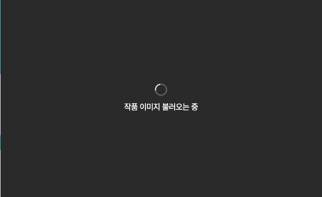

# 현장 이미지 대기를 재현한 SPACE 탐색 개선과 측정

상태: 개선 브랜치 커밋·PR 검토용. main 병합·운영 배포·현장 재검증 전.

## 배경과 문제 정의

전시 관계자로부터 연결이 좋지 않을 때 관람객이 작품 이미지를 기다리거나 메시지 작성·메뉴 이동에 불편을 겪는다는 제보를 받았다. 2026-10-29 현장 PC를 직접 조작해 프로필 사진 지연과 지도 작품 미리보기 대기를 기록했다. 현장 네트워크의 실제 속도·TTFB·다운로드·디코딩 시간은 측정하지 않았으므로, Wi-Fi가 유일한 원인이라고 단정하지 않는다.

전시 종료가 임박해 개선 후 동일 현장에 다시 방문하기 어려웠다. 검증을 생략하는 대신, 현장에서 관찰한 **이미지 대기가 작품 식별까지 막는 증상**을 로컬 저속 조건에서 재현했다. 메시지·헤더·프로필·낙서는 이번 변경과 구분해 후속 과제로 남겼다.

코드에서 확인한 구조는 이미지가 ready가 되기 전 작품명·작가명까지 함께 숨기는 것이었다. 최종 화질을 낮추는 대신 **정보·작은 미리보기·최종 이미지의 준비 조건을 분리**했다. 실패 시 정보를 유지하고 명시적으로 재시도할 수 있게 했다.

## 핵심 결과와 해석

아래는 대표 작품 윤이지의 「3et」을 이미 열린 지도에서 선택한 구간이다. 전후 각각 정상/저속 × cold/warm × 10회, 총80회다. 작품 정보 표시는 현재 제목과 조상 요소의 opacity가0.99 이상인 첫 frame이며, 관람객의 인지 시간을 직접 측정한 지표는 아니다.

| 조건 | 작품 정보 표시 중앙값: 이전 → 개선 | 고화질 준비 중앙값: 이전 → 개선 |
| --- | ---: | ---: |
| 정상·cold | 8 → 8ms | 8 → 8ms |
| 정상·warm | 4 → 3ms | 4 → 4ms |
| 저속·cold | 822 → 8ms | 822 → 824ms |
| 저속·warm | 5 → 4ms | 5 → 4ms |

중앙값은 정렬한10개 중 가운데 두 값의 평균을 구하고 ms 정수로 반올림했다. 이번80회에서는20초 timeout이 없었다. 원시 소수값과 개별 표본은 아래 자료에 그대로 남겼다.

**고화질 다운로드 자체가 빨라진 결과는 아니다.** 저속 첫 선택에서 이미지 대기를 작품 정보의 대기로 연결하지 않도록 바꾼 결과다. 캐시가 있는 경우는 기존도 빨랐고 수 ms 차이를 사용자 성과로 주장하지 않는다. 한 작품·한 로컬 환경의 결과를 전체 관람객의 개선율이나 만족도·이탈률로 일반화하지 않는다.

화질·디자인과 비용:

- 최종 선택 이미지의 URL 매개변수 w=640/q=75, encoded body19,776bytes를 유지했다. 최종 source/sizes/quality를 변경하지 않았다.
- 고화질 준비 후 400·822·1020·1350·1920·2560px 화면을 마스킹 없이 비교한 결과, 여섯 조건 모두 변경 픽셀0이었다.
- 초기 HTML encoded body10,909→13,932bytes(+3,023), 동일 출처 script encoded body 합918,564→919,097bytes(+533). 작은 미리보기 선제공의 비용이며 최초 페이지 진입 속도를 개선했다는 주장은 하지 않는다.

## 원시 자료와 출처

보존 폴더: [evidence/2026-10-30-space-preview](./evidence/2026-10-30-space-preview/)

| 자료 | 내용 |
| --- | --- |
| [baseline.json](./evidence/2026-10-30-space-preview/baseline.json) | 2026-10-30 17:04:24 KST 기준본 비녹화40회 원시값 |
| [candidate.json](./evidence/2026-10-30-space-preview/candidate.json) | 같은 날17:04:39 KST 개선 작업본 비녹화40회 원시값 |
| [samples.csv](./evidence/2026-10-30-space-preview/samples.csv) | 버전·연결·캐시·run·정보/고화질 시간·timeout을 보존한80행 |
| [summary.json](./evidence/2026-10-30-space-preview/summary.json) | 조건별 표본 수·중앙값·timeout·원시 파일 SHA-256 |
| [visual-comparison.json](./evidence/2026-10-30-space-preview/visual-comparison.json) | 여섯 화면 폭의 크기와 변경 픽셀 수 |

기준 코드는 [5328fc2](https://github.com/KNU-Design-Web-2026/knud2026/commit/5328fc2ac56d0a9e8d0829ec66c1480f003a34a5)다. 개선 코드의 핵심 동작은 [b059e0c](https://github.com/KNU-Design-Web-2026/knud2026/commit/b059e0cd57009eb6b4e157f7e3b7b88c70e55761)에 담았다. 원시 측정은 커밋 전 수행했으므로 candidate.json의 sha는 당시 기록인5328fc2+working-tree를 **수정하지 않았다**.

이후 촬영 시 저장한 핵심7개 파일(map/CSS/work-items/booths/submitted-works/대상 manifest/reducer)의 SHA-256과 b059e0c의 해당 Git 내용을 대조해 일치함을 확인했다. 이것은 촬영 소스와 커밋의 연결이며, 소스 해시를 남기지 않은 과거 측정 빌드 전체의 동일성을 소급 증명하지는 않는다. 운영 배포 결과도 아니다.

## 전후 화면

아래 두 화면은 동일 이미지 요청을 **인위적으로8초 보류한 기능 검사**의 대기 상태다. 저속 네트워크 실측 시간이나 성능 통계의 표본으로 사용하지 않았다.

| 이전: 이미지와 함께 작품 정보도 대기 | 개선: 작품 정보·작은 미리보기 선제공 |
| --- | --- |
|  |  |

오류 시에도 정보는 남기고 재시도 경로를 제공한다. 다음 화면은 첫 요청을 abort한 합성 오류 검사다.


[모바일 폭400px 전체 화면](./evidence/2026-10-30-space-preview/candidate-mobile-400.png)도 보존했다. Chromium의 좁은 viewport 캡처이며 실제 iPhone 촬영은 아니다.

## 실험 환경과 분리한 검증

측정 환경:

- macOS14.6 arm64, Node24.4.0, pnpm9.15.3, Playwright1.61.1 / Chromium149.0.7827.55.
- 독립 기준본과 개선본을 같은 Next16.3.0 Turbopack production build로 실행. localhost3101/3102.
- 1920×1080/DPR1, 서버 이미지 캐시 warm, 서비스 워커 차단.
- 저속: download50,000B/s(0.4Mbps), upload25,000B/s(0.2Mbps), latency400ms. 현장 실측값이 아닌 통제 조건이며 패킷 손실은 넣지 않았다.
- 페이지·폰트 준비 후 지도 선택 구간만 CDP 제한. 최초 페이지 진입 성능은 검사 범위가 아니다.
- cold: 새 context에서 대상 작품 첫 선택. warm: 같은 context에서 대상 이미지를 한 번 연 뒤 다른 작품을 거쳐 재선택.
- 수치 실행에는 video/trace/요청 interception이 없다. E2E와 동시에 측정한 임시 실행은 버리고 전후 버전을 직렬로 실행했다.
- warm에서는 이전 로딩의 ResourceTiming 항목만 남을 수 있으므로 재선택의 신규 요청으로 중복 계산하지 않는다.

기능·화면 검증:

- 지연·실패·재시도·역순 완료·키보드·터치·링크 hit target·가로 overflow와 reduced motion을 검사했다.
- 전체 E2E22개 통과, 적용하지 않는26개 조합은 skip. 동결 WebKit 검사는 실제 최신 iPhone/Safari 검사로 표현하지 않는다.
- 회귀/단위220개, lint/type-check/production build 통과.
- 요청을8초 보류하거나 abort하는 기능 검사는 실제 전송 속도나 캐시 성능 측정과 분리했다.

## 다시 실행하기

독립 기준 디렉터리에5328fc2를 준비하고 의존성·공개 자산으로 production build/start를 실행한다. 별도 기준 경로의 node_modules가 외부 symlink이면 Turbopack root 제약이 있으므로 독립 설치 또는 복사본을 사용한다. .env를 복사하거나 운영 DB에 테스트 메시지를 쓰지 않는다. 개선본도 production build/start를 준비한 뒤 저장소 루트에서:

```sh
pnpm exec playwright install chromium webkit
pnpm exec playwright test
node scripts/performance/measure-space-preview.mjs --url=http://127.0.0.1:3101 --label=baseline --sha=5328fc2 --output=artifacts/space-preview/baseline.json --runs=10
node scripts/performance/measure-space-preview.mjs --url=http://127.0.0.1:3102 --label=candidate --sha=실제로측정한커밋 --output=artifacts/space-preview/candidate.json --runs=10
node scripts/performance/compare-space-visuals.mjs
pnpm evidence:space --baseline-root=/절대/경로/독립기준본 --baseline-ref=5328fc2
```

명령의 sha 인자는 라벨이므로 실행자가 실제 코드를 확인해야 한다. 기존 보존 자료를 덮어쓰지 말고 새 실행은 새 경로·시각·커밋을 기록한다. 기능 검사, 성능 표본, 영상 증거를 같은 통계로 합치지 않는다.

## 영상·trace와 향후 기록 위치

현재 영상5개·trace5개·전체 E2E 녹화 보고서는 로컬의 artifacts/space-preview/recordings/2026-10-30T08-20-30-179Z/에 보존했다. 이 폴더는 Git 제외 대상이므로 PR의 다른 독자가 원격에서 열 수 있는 링크가 아니다. 원격에서는 이 문서의 PNG·원시 수치·재현 도구를 확인할 수 있다. 영상까지 공유하려면 공개 범위를 확인한 뒤 Discussion 첨부나 별도 읽기 전용 보관소에 올리고 이 문서에 영구 링크를 추가한다. 아직 업로드했다고 주장하지 않는다.

역할 분담:

- **이 문서:** 배경·결정·측정 정의·조건·결과·한계의 기준 기록.
- **evidence/날짜별 폴더:** 수정하지 않은 원시JSON/CSV, 작은 화면 증거. 새로운 측정은 기존 파일을 덮지 않고 별도 실행 폴더로 추가.
- **PR:** 변경 범위·검증 요약·리뷰·코드 커밋을 연결.
- **Discussion #51:** 문제 제보·실험 계획·사용자 재확인 등 시간순 경과를 요약하고 이 문서와 PR을 연결. 이번 요청에서는 Discussion을 수정하지 않았다.
- **포트폴리오:** 사용자 문제·핵심 결정·대표 수치만 압축하고 이 기록으로 근거 연결. 현장 효과·만족도·이탈률은 별도 확인 전 주장하지 않는다.

상세 구현은 [디자인 QA](../design/qa/2026-10-30-space-preview-resilience.md), 영상 도구는 [Playwright 증거 기록](../design/qa/2026-10-30-space-playwright-evidence.md), 표현 범위는 [포트폴리오 초안](../design/qa/2026-10-30-field-portfolio-story.md)을 참고한다.
